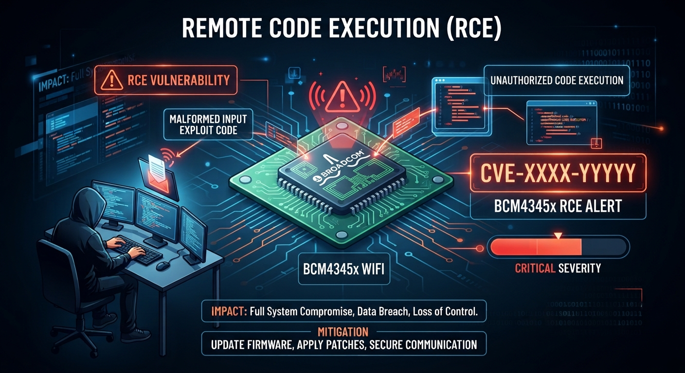
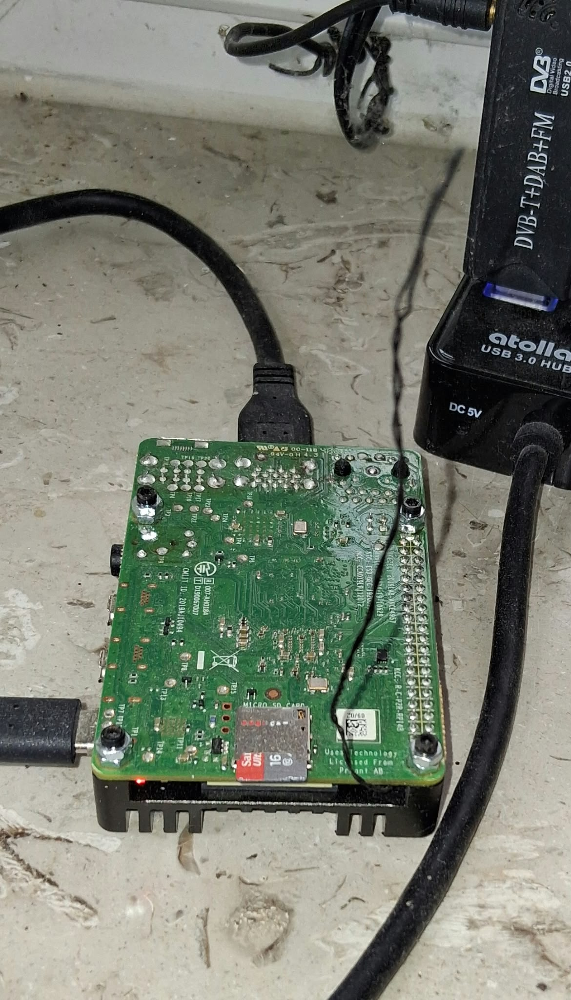
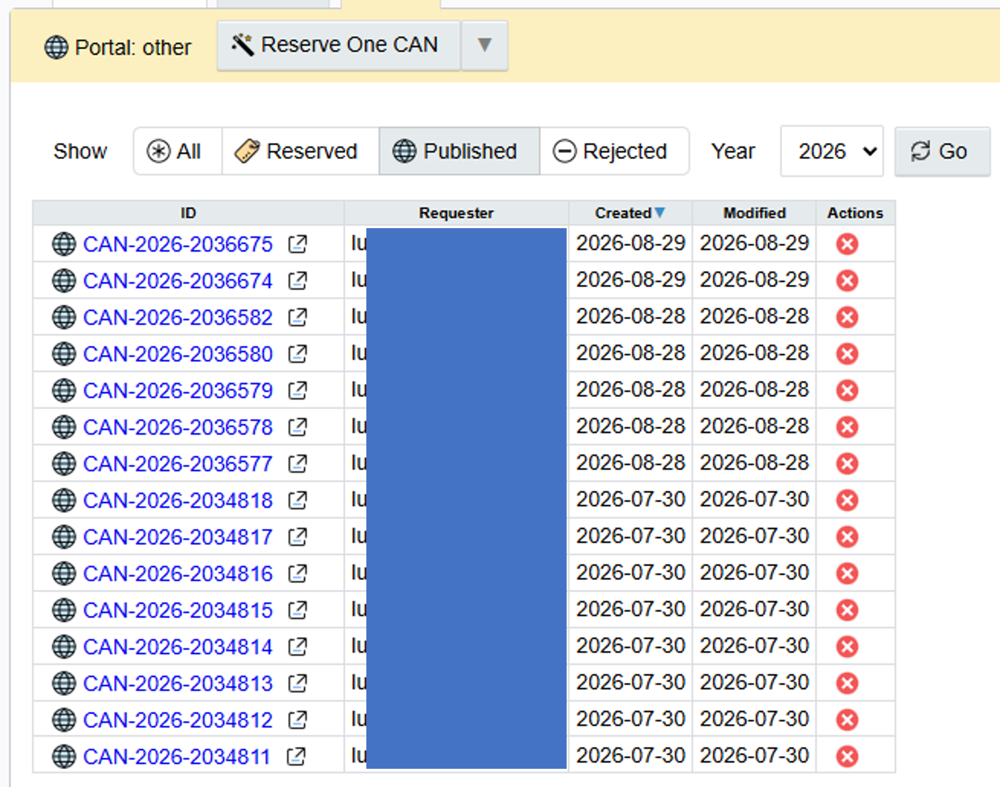

# BCM4345x Wi-Fi firmware vulnerabilities

I have an old Raspberry Pi that runs some programs and scripts. Nothing special, but it has had a WiFi problem from the start. It randomly stops working

After many tests, I noticed the metal cooling on the board was covering the built-in antenna. I looked at the board, and I saw that the pcb traces were already designed to support an external antenna. So I cut one trace and soldered a short wire of the right length directly to it

Things started working better with a good signal, but the WiFi still kept freezing for no clear reason. I wanted to find out why

Spoiler: it happens when the router changes channels. The firmware or driver fails to follow the change. Fix: set a fixed channel on the router

To understand the problem, I downloaded BCM firmware v7.45.265 from my Raspberry Pi and started disassembling it. I won't describe the whole process, as I don't think many people would be interested. But here are the things I found by chance

Before getting into the technical details: I reported the issues to Infineon's PSIRT and Security Raspberry. Even though Infineon said the component was obsolete, they checked the issues and fixed all the bugs I found, making a new version 7.45.306. (I haven't had time to check the new version yet)

I asked them to assign CVEs, but Infineon refused to handle the CVE assignment directly. They said researchers have to do it themselves. I requested 8 separate CVE IDs from MITRE. They have been stuck there since July (other organizations seem not to be interested).

My personal opinion: I think these reporting and CVE assignment systems are ridiculous. They ignore you; if you are lucky, they ask for proof after proof and pocs, waste a lot of your time, and then... 

Long story short: there is no cve assigned yet

Btw, looking on google, I found out that the BCM4345x is used in many commercial modules and many devices. So, if you have a Raspberry Pi or another device that uses this chip, these are the vulnerabilities found in the older firmware versions.

I found 8 vulnerabilities, and they have the same main cause: there is no bounds check before a memory copy. The copy length is read directly from an Information Element in an 802.11 management frame (beacon, probe, authentication, or association). 

This value is controlled by the attacker and is used without checking if it fits in the destination buffer.

1. **Stack overflow** — authentication/association with a malicious access
   point.
2. **Stack overflow** — first of two bugs in the same function, in an
   association response.
3. **Stack overflow** — second, separate bug in the same function, in an
   association response.
4. **Stack overflow** — SSID copy during passive scanning.
5. **Heap overflow** — heap entry during passive scanning.
6. **Heap overflow** — beacon/probe processing during passive scanning.
7. **Heap overflow** — association handling.
8. **Heap overflow** — any frame with a vendor-specific IE.

Three bugs (4, 5 and 6) can be triggered during passive scanning alone. The target device does not need to connect to or authenticate with the attacker. It only needs to scan for nearby networks and process the malicious frame

Five bugs ( 1, 2, 3, 7 and 8) can be triggered through a rogue AP or evil twin during authentication or association

Bug 8 is the most serious in terms of overflow size. It uses a 16-bit length controlled by the attacker, allowing a copy of up to 255 bytes. This is much larger than the typical 8-bit IE fields in the other cases

**The firmware has no security protections: no aslr, no stack canary, and memory is fully readable, writable and executable. This makes it possible that an attacker could go beyond a simple crash and achieve remote code execution RCE, rather than only causing a denial of service (DoS)**

## Original article

[Read the original article on LinkedIn](https://www.linkedin.com/pulse/paradox-vulnerability-disclosure-luigi-origa-pud4f)
